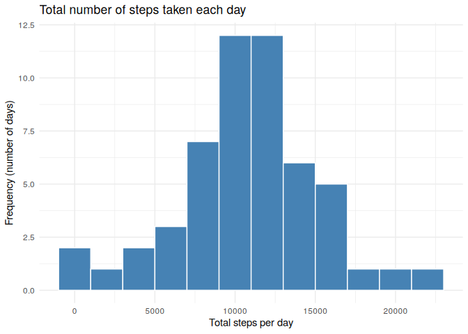
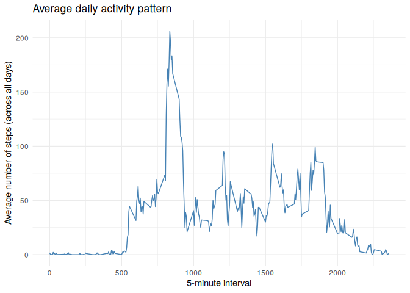
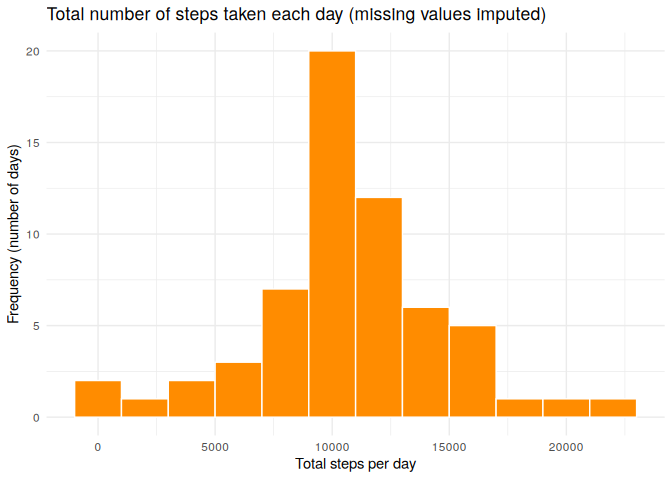
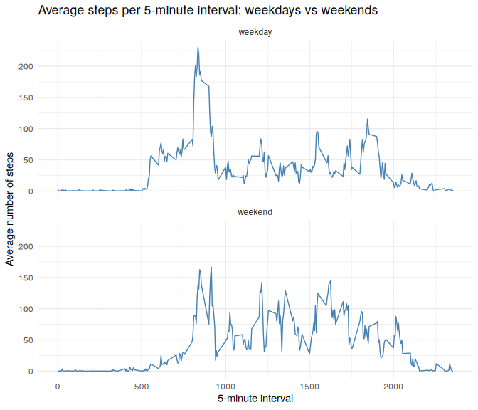

```r
knitr::opts_chunk$set(echo = TRUE, fig.path = "figure/")

# Weekday names are locale dependent, so fix the locale for reproducibility
Sys.setlocale("LC_TIME", "C")
```

```
## [1] "C"
```

```r
library(ggplot2)
library(dplyr)
```

```
## 
## Attaching package: 'dplyr'
```

```
## The following objects are masked from 'package:stats':
## 
##     filter, lag
```

```
## The following objects are masked from 'package:base':
## 
##     intersect, setdiff, setequal, union
```


## Loading and preprocessing the data

The raw data ships with this repository as `activity.zip`. The chunk below unzips
it if needed, reads it in, and converts the `date` column from character to
`Date`. The `interval` column is left as an integer identifier (0, 5, ..., 2355).


```r
if (!file.exists("activity.csv")) {
  unzip("activity.zip")
}

activity <- read.csv("activity.csv", stringsAsFactors = FALSE)
activity$date <- as.Date(activity$date, format = "%Y-%m-%d")

str(activity)
```

```
## 'data.frame':	17568 obs. of  3 variables:
##  $ steps   : int  NA NA NA NA NA NA NA NA NA NA ...
##  $ date    : Date, format: "2012-10-01" "2012-10-01" ...
##  $ interval: int  0 5 10 15 20 25 30 35 40 45 ...
```

```r
summary(activity)
```

```
##      steps             date               interval     
##  Min.   :  0.00   Min.   :2012-10-01   Min.   :   0.0  
##  1st Qu.:  0.00   1st Qu.:2012-10-16   1st Qu.: 588.8  
##  Median :  0.00   Median :2012-10-31   Median :1177.5  
##  Mean   : 37.38   Mean   :2012-10-31   Mean   :1177.5  
##  3rd Qu.: 12.00   3rd Qu.:2012-11-15   3rd Qu.:1766.2  
##  Max.   :806.00   Max.   :2012-11-30   Max.   :2355.0  
##  NA's   :2304
```

The dataset has 17,568 observations covering
61 days, with
2,304 missing values in the
`steps` column.


## What is mean total number of steps taken per day?

For this part of the assignment the missing values are ignored. Intervals with
`NA` steps are dropped before the daily totals are computed, so a day
contributes only the intervals that were actually recorded.


```r
daily_steps <- activity %>%
  filter(!is.na(steps)) %>%
  group_by(date) %>%
  summarise(total_steps = sum(steps), .groups = "drop")

head(daily_steps)
```

```
## # A tibble: 6 x 2
##   date       total_steps
##   <date>           <int>
## 1 2012-10-02         126
## 2 2012-10-03       11352
## 3 2012-10-04       12116
## 4 2012-10-05       13294
## 5 2012-10-06       15420
## 6 2012-10-07       11015
```

### Histogram of the total number of steps taken each day


```r
ggplot(daily_steps, aes(x = total_steps)) +
  geom_histogram(binwidth = 2000, fill = "steelblue", colour = "white") +
  labs(
    title = "Total number of steps taken each day",
    x = "Total steps per day",
    y = "Frequency (number of days)"
  ) +
  theme_minimal()
```

<!-- -->

### Mean and median of the total number of steps per day


```r
mean_steps   <- mean(daily_steps$total_steps)
median_steps <- median(daily_steps$total_steps)

mean_steps
```

```
## [1] 10766.19
```

```r
median_steps
```

```
## [1] 10765
```

The **mean** total number of steps taken per day is
**10,766.19** and the
**median** is **10,765**.


## What is the average daily activity pattern?


```r
interval_avg <- activity %>%
  filter(!is.na(steps)) %>%
  group_by(interval) %>%
  summarise(avg_steps = mean(steps), .groups = "drop")

head(interval_avg)
```

```
## # A tibble: 6 x 2
##   interval avg_steps
##      <int>     <dbl>
## 1        0    1.72  
## 2        5    0.340 
## 3       10    0.132 
## 4       15    0.151 
## 5       20    0.0755
## 6       25    2.09
```

### Time series plot of the average steps per 5-minute interval


```r
ggplot(interval_avg, aes(x = interval, y = avg_steps)) +
  geom_line(colour = "steelblue") +
  labs(
    title = "Average daily activity pattern",
    x = "5-minute interval",
    y = "Average number of steps (across all days)"
  ) +
  theme_minimal()
```

<!-- -->

### The 5-minute interval with the maximum average number of steps


```r
max_row      <- interval_avg[which.max(interval_avg$avg_steps), ]
max_interval <- max_row$interval
max_value    <- max_row$avg_steps

max_row
```

```
## # A tibble: 1 x 2
##   interval avg_steps
##      <int>     <dbl>
## 1      835      206.
```

Interval **835** (that is, 08:35)
contains the maximum number of steps on average, at
**206.17** steps.


## Imputing missing values

### Total number of missing values


```r
total_missing <- sum(is.na(activity$steps))
total_missing
```

```
## [1] 2304
```

There are **2,304** rows with a missing
`steps` value. All of them fall on 8
days for which no data at all was recorded:


```r
activity %>%
  filter(is.na(steps)) %>%
  count(date, name = "missing_intervals")
```

```
##         date missing_intervals
## 1 2012-10-01               288
## 2 2012-10-08               288
## 3 2012-11-01               288
## 4 2012-11-04               288
## 5 2012-11-09               288
## 6 2012-11-10               288
## 7 2012-11-14               288
## 8 2012-11-30               288
```

### Imputation strategy

**Strategy: replace each missing value with the mean number of steps for that
same 5-minute interval, averaged across all days on which it was recorded.**

The daily activity pattern is strongly structured by time of day (near zero
overnight, a sharp morning peak), so the interval mean is a much better
estimate for a missing reading than a single overall daily mean would be. Since
every missing value belongs to a day with no readings at all, a per-day mean is
not available, which rules that option out anyway.


```r
activity_imputed <- activity %>%
  left_join(interval_avg, by = "interval") %>%
  mutate(steps = ifelse(is.na(steps), avg_steps, steps)) %>%
  select(steps, date, interval)

# Confirm that no missing values remain
sum(is.na(activity_imputed$steps))
```

```
## [1] 0
```

```r
str(activity_imputed)
```

```
## 'data.frame':	17568 obs. of  3 variables:
##  $ steps   : num  1.717 0.3396 0.1321 0.1509 0.0755 ...
##  $ date    : Date, format: "2012-10-01" "2012-10-01" ...
##  $ interval: int  0 5 10 15 20 25 30 35 40 45 ...
```

### Histogram of total steps per day after imputation


```r
daily_steps_imputed <- activity_imputed %>%
  group_by(date) %>%
  summarise(total_steps = sum(steps), .groups = "drop")

ggplot(daily_steps_imputed, aes(x = total_steps)) +
  geom_histogram(binwidth = 2000, fill = "darkorange", colour = "white") +
  labs(
    title = "Total number of steps taken each day (missing values imputed)",
    x = "Total steps per day",
    y = "Frequency (number of days)"
  ) +
  theme_minimal()
```

<!-- -->

### Mean and median after imputation


```r
mean_imputed   <- mean(daily_steps_imputed$total_steps)
median_imputed <- median(daily_steps_imputed$total_steps)

mean_imputed
```

```
## [1] 10766.19
```

```r
median_imputed
```

```
## [1] 10766.19
```


```r
comparison <- data.frame(
  dataset = c("Missing values ignored", "Missing values imputed"),
  mean    = c(mean_steps, mean_imputed),
  median  = c(median_steps, median_imputed)
)
comparison
```

```
##                  dataset     mean   median
## 1 Missing values ignored 10766.19 10765.00
## 2 Missing values imputed 10766.19 10766.19
```

**Do these values differ from the estimates in the first part of the
assignment?** The mean is unchanged at
10,766.19, and the median
moves only slightly, from 10,765 to
10,766.19.

**What is the impact of imputing missing data on the estimates of the total
daily number of steps?** Each of the eight previously empty days is now filled
with exactly the average daily profile, so each contributes a total equal to the
overall mean. The centre of the distribution therefore does not move, but the
histogram bar containing the mean grows taller by eight days, and the total
number of steps across the whole study period rises. The main effect is a
reduction in apparent variability rather than a shift in level, which is a known
drawback of mean imputation: it understates the true spread of the data.


## Are there differences in activity patterns between weekdays and weekends?

### Creating the weekday/weekend factor variable


```r
activity_imputed <- activity_imputed %>%
  mutate(
    day_type = factor(
      ifelse(weekdays(date) %in% c("Saturday", "Sunday"), "weekend", "weekday"),
      levels = c("weekday", "weekend")
    )
  )

table(activity_imputed$day_type)
```

```
## 
## weekday weekend 
##   12960    4608
```

### Panel plot comparing weekdays and weekends


```r
interval_daytype <- activity_imputed %>%
  group_by(interval, day_type) %>%
  summarise(avg_steps = mean(steps), .groups = "drop")

ggplot(interval_daytype, aes(x = interval, y = avg_steps)) +
  geom_line(colour = "steelblue") +
  facet_wrap(~ day_type, ncol = 1) +
  labs(
    title = "Average steps per 5-minute interval: weekdays vs weekends",
    x = "5-minute interval",
    y = "Average number of steps"
  ) +
  theme_minimal()
```

<!-- -->


```r
interval_daytype %>%
  group_by(day_type) %>%
  summarise(
    mean_steps_per_interval = mean(avg_steps),
    peak_interval           = interval[which.max(avg_steps)],
    peak_avg_steps          = max(avg_steps),
    .groups = "drop"
  )
```

```
## # A tibble: 2 x 4
##   day_type mean_steps_per_interval peak_interval peak_avg_steps
##   <fct>                      <dbl>         <int>          <dbl>
## 1 weekday                     35.6           835           230.
## 2 weekend                     42.4           915           167.
```

**Yes, the patterns differ.** On weekdays activity starts earlier and is
dominated by a single sharp morning peak around interval 835 (08:35), after
which the rest of the day is comparatively flat, consistent with a commute
followed by a sedentary working day. On weekends activity begins later, the
morning peak is lower, and steps are spread more evenly across the middle of the
day, giving a higher average level of activity through the afternoon and into
the evening.
